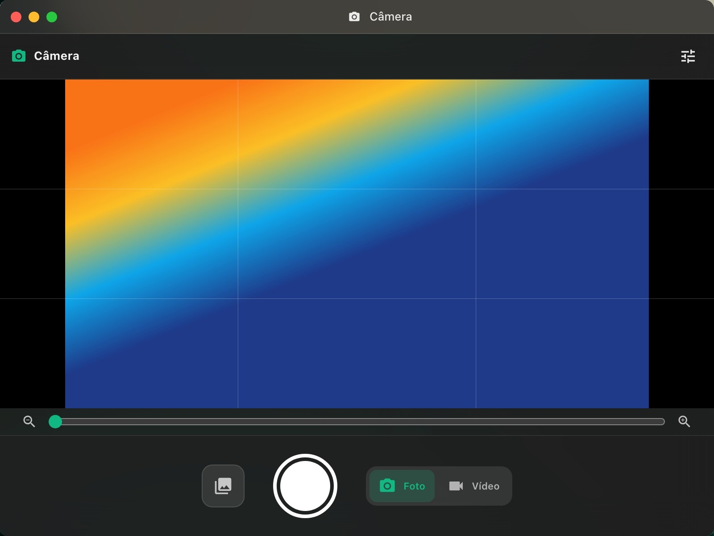
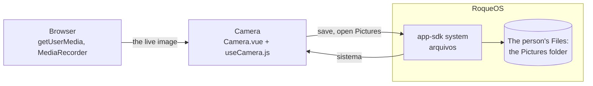

# Camera

_[Português](README.pt-BR.md) | English_

The Camera of [RoqueOS](https://roqueos.com.br): photos and videos with the device camera, with zoom (the device's own, or by cropping when it has none), torch, camera switching, a 3, 5 or 10 second timer, aspect ratio (full, 1:1, 4:3, 16:9), resolution from 480p to 4K, rule-of-thirds or golden grid, front camera mirroring and a level. The photo or video goes to Pictures in Files, to a download, or to the device's share sheet. In all ten RoqueOS languages.

Free to use at [roqueos.com.br](https://roqueos.com.br), on the computer, the phone and the TV.



## Why it is its own repository

The Camera was born inside RoqueOS, which is closed. On 28/09/2026 it moved to its own repository in the [roqueos-apps](https://github.com/roqueos-apps) organization, in Wave 4 of Goal 28. RoqueOS installs it by tag, as a git dependency, and it talks to RoqueOS only through the [`app-sdk`](https://github.com/roqueos-apps/app-sdk). The screen is built with the [`ui`](https://github.com/roqueos-apps/ui) kit. The same code runs inside RoqueOS, alone in the browser (`yarn dev`) and in the tests.

## Architecture



```text
app.json            who it is: permanent id (camera), name and description in ten languages,
                    icon, colour, window, the capability it asks for and the folder it opens
i18n/<language>.json  the screen texts, one file per language
src/
  index.js          definirApp: creates the app's own Vue app inside the element RoqueOS gives
  Camera.vue        the screen: viewfinder, framing, shutter, the capture and the settings
  useCamera.js      the engine: the MediaStream, the photo on canvas, video, zoom and torch
  textos.js         loads the language JSON (with ?raw) and translates a key
  camera.scss       the look
dev/main.js         yarn dev: the Camera in a fake RoqueOS window
test/               Vitest: the screen through the SDK, the engine, and the text keys
```

It talks to RoqueOS only through the SDK's `sistema`, with the optional capability declared in `app.json`. `arquivos`: `salvar` puts the photo (`image/jpeg`) or video (`video/webm`) in Pictures with the usual name (`RoqueOS_Photo_<time>.jpg`, `RoqueOS_Video_<time>.webm`); `abrirPasta` opens Pictures in the Finder, from the gallery button. The Camera declares `"pastas": ["Imagens"]`: it is the only folder it can open, and it never sees a path nor lists the person's files. It also uses `idioma`, `desempenho` (the light profile removes the animated mesh, the blur and the countdown pulse), `avisar` and `metricas` (the `photo_capture` event, the same as before).

The camera and microphone it asks straight from the browser (`getUserMedia`), because the system mediates nothing there: the SDK has no `camera` capability. The microphone only comes in for video. Without an account the system refuses to save (`sem-conta`): the Camera says you need to sign in, the capture stays on screen, and download and share keep working. The live image goes nowhere; a capture leaves only when the person presses save, download or share, and closing the window turns the camera off.

## Getting started

You need Node 22 or newer (`.nvmrc` says 24) and Yarn 1.22.

```bash
yarn install --ignore-scripts
yarn dev          # the Camera in a fake RoqueOS window, on a local account
yarn verificar    # lint, format, tests and app check: the same as CI and pre-push
yarn test         # tests only
```

`yarn dev` asks the browser for the real camera. What you save goes to in-memory Files and is gone on F5. `?idioma=ar-AR` opens in Arabic, `?leve=1` as a weak device sees it, `?convidado=1` without an account. The step by step is in [docs/GETTING-STARTED.md](docs/GETTING-STARTED.md).

## Parity with the app from before

`paridade.json` is the inventory of what the Camera did inside RoqueOS and what happened to each item on the move out: `mantida` (kept), `mudou` (changed, with a note) or `perdida` (lost, only with a written decision). Each item cites the test in this repository that proves it, or the evidence; today 48 items, 41 kept, 7 changed, 0 lost. RoqueOS checks the file in the installed package before accepting a version. Changed a feature, or a test cited there? Update the inventory in the same commit.

## Status and limits

On 18/11/2026 RoqueOS installs version 0.1.3 (the tag pinned in its `package.json`). The known limits, each with its source, are in [docs/ARCHITECTURE.md](docs/ARCHITECTURE.md#9-known-limits): the light profile is read only when the window opens, the focus ring is a gesture without focusing, a video is always labelled `video/webm`, and no automated test runs on a real camera.

## Documentation

Start at the [documentation index](docs/INDEX.md). The documents: [getting started](docs/GETTING-STARTED.md), [architecture](docs/ARCHITECTURE.md), [reference](docs/REFERENCE.md), [operations](docs/OPERATIONS.md), [when it breaks](docs/WHEN-IT-BREAKS.md), [glossary](docs/GLOSSARY.md), [integrations](docs/INTEGRATIONS.md), [testing](docs/TESTING.md) and [threat model](docs/THREAT-MODEL.md).

## Contributing

Read [CONTRIBUTING.md](CONTRIBUTING.md). Every commit carries `Signed-off-by` (DCO), and CI checks it. A security flaw goes through [SECURITY.md](SECURITY.md), never a public issue.

## Credits and licence

[MIT](LICENSE). The icons are [Material Icons](https://fonts.google.com/icons) (Apache-2.0), through the UI kit; see [ASSETS.md](ASSETS.md). The RoqueOS name and brand belong to LEVELHARD and are not covered by the licence.
