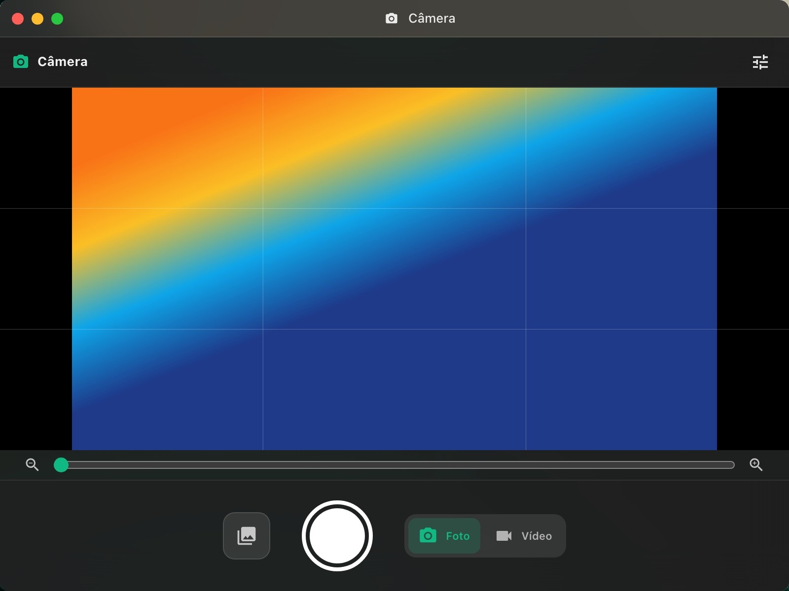
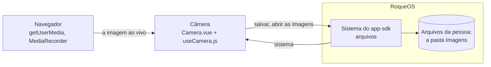

# Câmera

_Português | [English](README.md)_

A Câmera do [RoqueOS](https://roqueos.com.br): fotos e vídeos com a câmera do aparelho, com zoom (o do aparelho, ou por recorte quando ele não tem), lanterna, troca entre as câmeras, temporizador de 3, 5 ou 10 segundos, proporção (cheia, 1:1, 4:3, 16:9), resolução de 480p a 4K, grade de terços ou áurea, espelho da câmera frontal e nível. A foto ou o vídeo vai para as Imagens dos Arquivos, para o download ou para o compartilhar do aparelho. Nos dez idiomas do RoqueOS.

Use de graça em [roqueos.com.br](https://roqueos.com.br), no computador, no celular e na TV.



## Por que existe como repo

A Câmera nasceu dentro do RoqueOS, que é fechado. Em 28/09/2026 ela foi para o próprio repositório na organização [roqueos-apps](https://github.com/roqueos-apps), na Onda 4 do Goal 28. O RoqueOS a instala por uma tag, como dependência git, e ela fala com o RoqueOS só pelo [`app-sdk`](https://github.com/roqueos-apps/app-sdk). A tela é feita com o kit [`ui`](https://github.com/roqueos-apps/ui). O mesmo código roda dentro do RoqueOS, sozinho no navegador (`yarn dev`) e no teste.

## Arquitetura



```text
app.json            quem ela é: id permanente (camera), nome e descrição nos dez idiomas,
                    ícone, cor, janela, a capacidade que pede e a pasta que ela abre
i18n/<idioma>.json  os textos da tela, um arquivo por idioma
src/
  index.js          definirApp: cria o app Vue próprio dentro do elemento que o RoqueOS dá
  Camera.vue        a tela: o visor, o enquadramento, o disparador, a captura e os ajustes
  useCamera.js      o motor: o MediaStream, a foto no canvas, o vídeo, o zoom e a lanterna
  textos.js         carrega o JSON do idioma (com ?raw) e traduz uma chave
  camera.scss       o visual
dev/main.js         o yarn dev: a Câmera numa janela falsa do RoqueOS
test/               Vitest: a tela pelo SDK, o motor, e as chaves de texto
```

Ela fala com o RoqueOS só pelo `sistema` do SDK, com a capacidade opcional declarada no `app.json`. `arquivos`: `salvar` põe a foto (`image/jpeg`) ou o vídeo (`video/webm`) nas Imagens, com o nome de sempre (`RoqueOS_Photo_<hora>.jpg`, `RoqueOS_Video_<hora>.webm`); `abrirPasta` abre as Imagens no Finder, pelo botão da galeria. A Câmera declara `"pastas": ["Imagens"]`: é a única pasta que ela pode abrir, e ela nunca vê caminho nem lista os arquivos da pessoa. Usa também `idioma`, `desempenho` (o perfil leve tira a malha animada, o desfoque e a pulsação da contagem), `avisar` e `metricas` (o evento `photo_capture`, o mesmo de antes).

A câmera e o microfone ela pede direto ao navegador (`getUserMedia`), porque o sistema não media nada ali: o SDK não tem capacidade `camera`. O microfone só entra no modo vídeo. Sem conta, o sistema recusa salvar (`sem-conta`): a Câmera avisa que é preciso entrar, a captura continua na tela, e baixar e compartilhar continuam funcionando. A imagem ao vivo não vai a lugar nenhum; a captura só sai quando a pessoa aperta salvar, baixar ou compartilhar, e fechar a janela desliga a câmera.

## Como rodar

Precisa de Node 22 ou mais novo (o `.nvmrc` diz 24) e Yarn 1.22.

```bash
yarn install --ignore-scripts
yarn dev          # a Câmera numa janela falsa do RoqueOS, numa conta local
yarn verificar    # lint, formato, testes e app check: o mesmo do CI e do pre-push
yarn test         # só os testes
```

O `yarn dev` pede a câmera de verdade ao navegador. O que se salva vai para Arquivos em memória e some no F5. `?idioma=ar-AR` abre em árabe, `?leve=1` como o aparelho fraco vê, `?convidado=1` sem conta. O passo a passo está em [docs/pt-BR/COMECAR.md](docs/pt-BR/COMECAR.md).

## Paridade com o app de antes

`paridade.json` é o inventário do que a Câmera fazia dentro do RoqueOS e do que aconteceu com cada coisa na saída: `mantida`, `mudou` (com a nota do que mudou) ou `perdida` (só com a decisão escrita de quem decidiu). Cada item cita o teste deste repo que o prova, ou a evidência; hoje são 48 itens, 41 mantidos, 7 mudaram, 0 perdidos. O RoqueOS confere o arquivo no pacote instalado antes de aceitar a versão. Mudou uma funcionalidade, ou um teste citado ali? Atualize o inventário no mesmo commit.

## Estado e limites

Em 18/11/2026 o RoqueOS instala a versão 0.1.3 (a tag pinada no `package.json` dele). Os limites conhecidos, cada um com a fonte, estão em [docs/pt-BR/ARQUITETURA.md](docs/pt-BR/ARQUITETURA.md#9-limites-conhecidos): o perfil leve só é lido quando a janela abre, o anel de foco é um gesto sem focar, o vídeo sai sempre rotulado `video/webm`, e nenhum teste automático roda numa câmera de verdade.

## Documentação

Comece pelo [índice da documentação](docs/pt-BR/INDEX.md). Os documentos: [começar](docs/pt-BR/COMECAR.md), [arquitetura](docs/pt-BR/ARQUITETURA.md), [referência](docs/pt-BR/REFERENCIA.md), [operação](docs/pt-BR/OPERACAO.md), [quando quebra](docs/pt-BR/QUANDO-QUEBRA.md), [glossário](docs/pt-BR/GLOSSARIO.md), [integrações](docs/pt-BR/INTEGRACOES.md), [testes](docs/pt-BR/TESTES.md) e [modelo de ameaças](docs/pt-BR/MODELO-DE-AMEACAS.md).

## Contribuir

Leia o [guia de contribuição](docs/pt-BR/CONTRIBUTING.md). Todo commit leva `Signed-off-by` (DCO), e o CI confere. Falha de segurança vai pelo [SECURITY.md](SECURITY.md), nunca por issue pública.

## Créditos e licença

[MIT](LICENSE). Os ícones são do [Material Icons](https://fonts.google.com/icons) (Apache-2.0), pelo kit de interface; veja o [ASSETS.md](ASSETS.md). O nome e a marca RoqueOS são da LEVELHARD e não fazem parte da licença.
