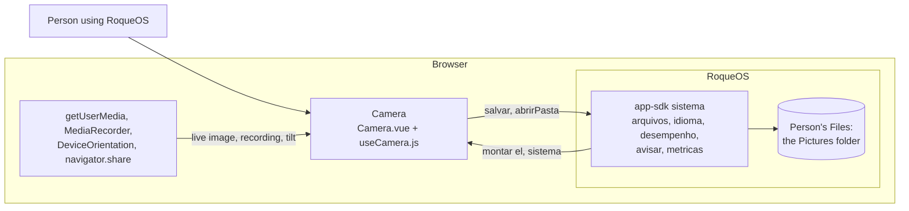
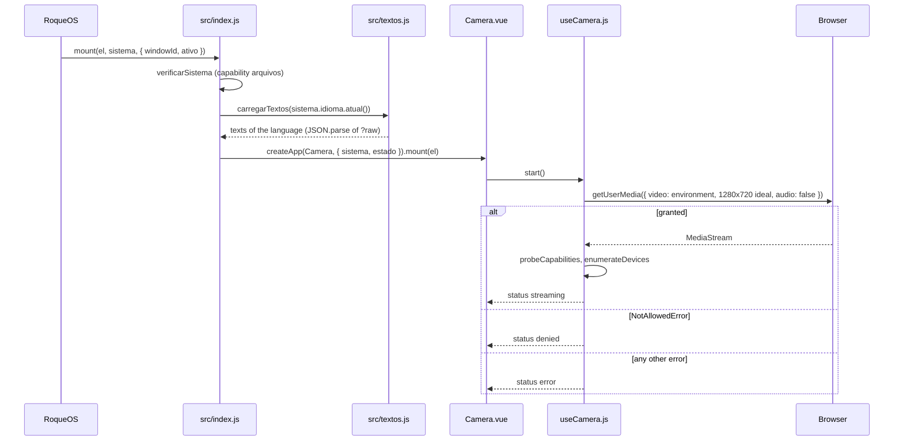
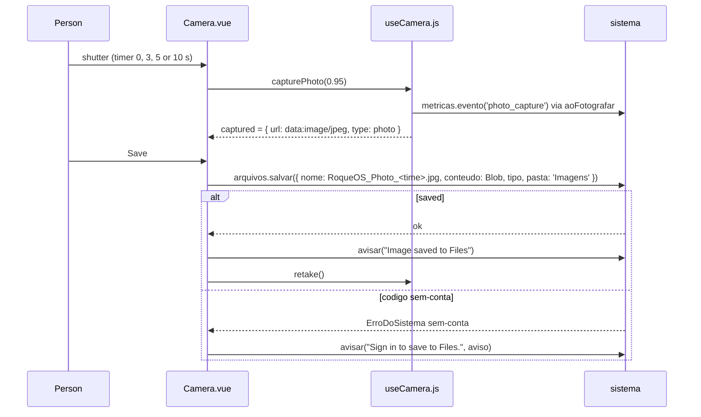
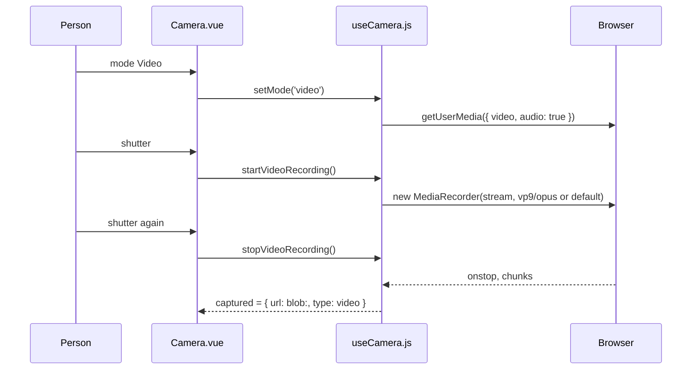
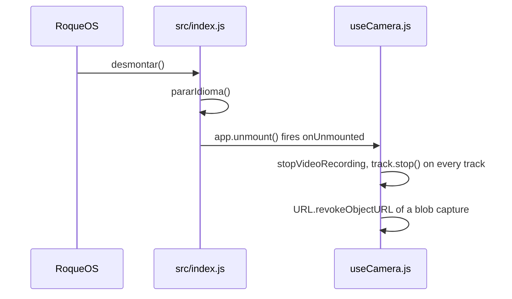

# Architecture

_[Português](pt-BR/ARQUITETURA.md) | English_

> **For whom:** whoever is about to change the Camera and wants the whole picture in half an hour: a contributor, the maintainer, an agent.
> **What is here:** the idea, the context, where the code runs, each component with its file, the four main flows in sequence diagrams, the contracts that cross a boundary, security, the design decisions and the known limits.
> **Where to go for the rest:** to run it, [GETTING-STARTED.md](GETTING-STARTED.md); every command and file, [REFERENCE.md](REFERENCE.md); how RoqueOS talks to it, [INTEGRATIONS.md](INTEGRATIONS.md); what it protects, [THREAT-MODEL.md](THREAT-MODEL.md).

## Table of contents

1. [The idea in one paragraph](#1-the-idea-in-one-paragraph)
2. [Context: who uses it and what it depends on](#2-context-who-uses-it-and-what-it-depends-on)
3. [Processes and where they run](#3-processes-and-where-they-run)
4. [Components](#4-components)
5. [The main flows](#5-the-main-flows)
6. [Data and contracts](#6-data-and-contracts)
7. [Security and secrets](#7-security-and-secrets)
8. [Design decisions](#8-design-decisions)
9. [Known limits](#9-known-limits)
10. [How the diagrams are made](#10-how-the-diagrams-are-made)

## 1. The idea in one paragraph

The Camera is a RoqueOS app that lives in its own repository. It is a Vue screen ([`src/Camera.vue`](../src/Camera.vue)) on top of an engine that owns the `MediaStream` ([`src/useCamera.js`](../src/useCamera.js)), wrapped by `definirApp` from the `app-sdk` ([`src/index.js`](../src/index.js)). The camera and the microphone come straight from the browser (`getUserMedia`); everything that belongs to RoqueOS (saving to Files, opening the Pictures folder, the language, the light profile, notices and metrics) comes through the `sistema` object the SDK hands to `montar`. RoqueOS installs it by tag as a git dependency, and the same code runs inside RoqueOS, alone in the browser (`yarn dev`) and in the tests. It moved out of the closed RoqueOS core on 28/09/2026, in Wave 4 of Goal 28 ([README.md](../README.md)).

## 2. Context: who uses it and what it depends on



| Depends on                                              | What it is for                                                                                         | What happens when it is missing or fails                                                                                                                                                |
| ------------------------------------------------------- | ------------------------------------------------------------------------------------------------------ | --------------------------------------------------------------------------------------------------------------------------------------------------------------------------------------- |
| `navigator.mediaDevices.getUserMedia`                   | the live image, and the microphone in video mode ([`src/useCamera.js`](../src/useCamera.js))           | without it the engine throws `getUserMedia unsupported` and the viewfinder shows "Camera unavailable" with Retry; a refused permission shows "Camera access denied" and how to allow it |
| `MediaRecorder`                                         | video recording                                                                                        | the engine tries `video/webm;codecs=vp9,opus`, then the browser default; if both fail it logs `[useCamera] MediaRecorder unsupported:` and does not record                              |
| `MediaStreamTrack.getCapabilities` / `applyConstraints` | native zoom and torch                                                                                  | no native zoom: zoom by cropping (CSS scale on screen, the same crop at capture); no torch: the torch button is not drawn                                                               |
| `DeviceOrientationEvent`                                | the level                                                                                              | on iOS the permission is asked with a tap; refused, the level stays off ([`src/Camera.vue`](../src/Camera.vue))                                                                         |
| `navigator.share`                                       | Share                                                                                                  | missing, or failing with anything but `AbortError`, Share falls back to Download                                                                                                        |
| `@roqueos-apps/app-sdk` (tag `v0.3.0`)                  | `definirApp`, the `sistema`, the dev and fake systems, `app check` ([`package.json`](../package.json)) | `mount` throws `[camera] o sistema não cumpre o contrato: ...` when the system does not offer `arquivos`                                                                                |
| `@roqueos-apps/ui` (tag `v0.6.0`)                       | the primitives `RosBotao`, `RosFolha`, `RosIcone`, `RosInterruptor`, `RosVazio`                        | the screen does not build; the kit arrives as `.vue` source and Vitest inlines it ([`vite.config.js`](../vite.config.js))                                                               |
| `vue` `^3.5.0` (peer)                                   | the app's own Vue instance                                                                             | supplied by RoqueOS, or by the dev dependency in this repo                                                                                                                              |
| The person's account                                    | `arquivos.salvar` and `arquivos.abrirPasta`                                                            | without an account the system refuses with `sem-conta`: the app says "Sign in to save to Files." and the capture stays on screen for Download or Share                                  |

## 3. Processes and where they run

| Where                                                                  | How it starts                                                                                                                                                                                | Who calls it                                                                                                                                                                                                 |
| ---------------------------------------------------------------------- | -------------------------------------------------------------------------------------------------------------------------------------------------------------------------------------------- | ------------------------------------------------------------------------------------------------------------------------------------------------------------------------------------------------------------ |
| Inside RoqueOS, in the person's browser, on the same origin as RoqueOS | RoqueOS imports the package (`ROSCamera: () => import('@roqueos-apps/camera')` in RoqueOS's generated app loaders) and calls `mount(el, sistema, { windowId, ativo })` when the window opens | the RoqueOS window manager; RoqueOS's own Vite compiles the app, and [`vite.config.js`](../vite.config.js) does not go with it                                                                               |
| Alone in a browser tab                                                 | `yarn dev` (Vite serving [`index.html`](../index.html), which loads [`dev/main.js`](../dev/main.js))                                                                                         | a developer; `montarNaJanelaFalsa` from the SDK draws a fake RoqueOS window sized from `app.json`, with in-memory Files on a local account                                                                   |
| Vitest on jsdom                                                        | `yarn test`                                                                                                                                                                                  | the developer, the `pre-push` hook of the kit, and CI                                                                                                                                                        |
| GitHub Actions                                                         | push to `main` and every pull request, forks included                                                                                                                                        | [`.github/workflows/ci.yml`](../.github/workflows/ci.yml) runs `yarn verificar`; [`.github/workflows/dco.yml`](../.github/workflows/dco.yml) checks `Signed-off-by` on pull requests. Neither reads a secret |

Nothing in this repository runs on a schedule, and there is no server.

## 4. Components

| File or folder                                                 | Responsibility                                                                                                                                                                                              | Who depends on it                                                                       |
| -------------------------------------------------------------- | ----------------------------------------------------------------------------------------------------------------------------------------------------------------------------------------------------------- | --------------------------------------------------------------------------------------- |
| [`app.json`](../app.json)                                      | who the app is: permanent `id` (`camera`), name and description in ten languages, icon `photo_camera`, color `#10b981`, window 800x600 (minimum 360x420), capability `arquivos`, folder `Imagens`           | RoqueOS (registry, window, permissions), `app check`, `dev/main.js`, `test/app.spec.js` |
| [`src/index.js`](../src/index.js)                              | `definirApp`: loads the language texts, creates the app's own Vue app inside the element RoqueOS gives, returns `{ ativar, desmontar }`; repeats the capabilities of `app.json` in `CAPACIDADES`            | RoqueOS (the package entry `.`), `dev/main.js`, the tests                               |
| [`src/Camera.vue`](../src/Camera.vue)                          | the screen: top bar, viewfinder, framing aids (aspect mask, grid, level, focus ring), pinch zoom, shutter with timer, mode switch, the capture actions (discard, download, save, share), the settings sheet | `src/index.js`                                                                          |
| [`src/useCamera.js`](../src/useCamera.js)                      | the engine: stream lifecycle and status, capability probing, zoom and torch, photo on canvas with mirror, aspect crop and CSS-zoom crop, video with `MediaRecorder`, cleanup on unmount                     | `src/Camera.vue`, `test/useCamera.spec.js`                                              |
| [`src/textos.js`](../src/textos.js)                            | the static map of ten loaders (`?raw` JSON), `carregarTextos` and `traduzir`                                                                                                                                | `src/index.js`, `src/Camera.vue`, `test/textos.spec.js`                                 |
| [`src/camera.scss`](../src/camera.scss)                        | the look: `--camera-*` variables over the contract's `--ros-*-rgb`, the light profile, the `@container (max-width: 560px)` compact layout                                                                   | `src/Camera.vue`, `test/estilo.spec.js`                                                 |
| [`i18n/`](../i18n/pt-BR.json)                                  | the screen texts, one JSON per language, flat keys                                                                                                                                                          | `src/textos.js`, `app check`, `test/textos.spec.js`                                     |
| [`dev/main.js`](../dev/main.js), [`index.html`](../index.html) | the standalone fake window for `yarn dev`                                                                                                                                                                   | the developer                                                                           |
| [`test/`](../test/app.spec.js)                                 | Vitest: the screen through the SDK, the engine, the text keys, the style rule; [`test/preparar.js`](../test/preparar.js) supplies what jsdom lacks                                                          | the gate, and `paridade.json` cites the test titles                                     |
| [`paridade.json`](../paridade.json)                            | the inventory of what the Camera did inside RoqueOS and what happened to each item (48 items: 41 kept, 7 changed, 0 lost)                                                                                   | RoqueOS, which checks it in the installed package                                       |
| [`ASSETS.md`](../ASSETS.md)                                    | origin and licence of media; the Camera has no `public/`                                                                                                                                                    | `app check`                                                                             |

## 5. The main flows

### 5.1 Opening the window

RoqueOS calls `mount`; the SDK checks the system against the declared capabilities; `montar` loads the texts of the current language and only then mounts Vue, so no button appears without a label ([`src/index.js`](../src/index.js)). On mount the screen calls `cam.start()`, which asks for the rear camera at 720p, with audio only in video mode ([`src/useCamera.js`](../src/useCamera.js)).



### 5.2 Taking and saving a photo

With a timer of 3, 5 or 10 seconds the shutter counts down first; then the engine draws the frame on a canvas (mirror for the front camera, aspect crop, CSS-zoom crop) and keeps a JPEG data URL at quality 0.95. Save turns it into a Blob and hands it to `sistema.arquivos.salvar` with the permanent name ([`src/Camera.vue`](../src/Camera.vue)).



### 5.3 Recording a video

Switching to video restarts the stream with the microphone. The shutter starts and stops a `MediaRecorder`; on stop the chunks become a `video/webm` Blob behind a `blob:` URL, and Save names it `RoqueOS_Video_<time>.webm` ([`src/useCamera.js`](../src/useCamera.js)).



### 5.4 Closing the window

Closing calls `desmontar`: it stops listening to language changes and unmounts Vue; the engine's `onUnmounted` stops every track, so the device light goes off, and revokes the `blob:` URL of an unsaved video ([`src/index.js`](../src/index.js), [`src/useCamera.js`](../src/useCamera.js)). The test "fechar a janela desliga a câmera e solta o ouvinte do idioma" in [`test/app.spec.js`](../test/app.spec.js) checks it.



## 6. Data and contracts

The app's face to RoqueOS is the default export of [`src/index.js`](../src/index.js), created by `definirApp({ id: 'camera', capacidades: ['arquivos'], montar })`. Everything it asks of the system, with the exact call:

```js
await sistema.arquivos.salvar({
  nome: 'RoqueOS_Photo_1727500000000.jpg', // or RoqueOS_Video_<Date.now()>.webm
  conteudo: blob,
  tipo: 'image/jpeg', // blob.type, or video/webm
  pasta: 'Imagens',
})
await sistema.arquivos.abrirPasta('Imagens')
sistema.metricas.evento('photo_capture')
sistema.avisar(texto, { tipo: 'sucesso' | 'aviso' | 'erro', titulo })
sistema.idioma.atual() // and sistema.idioma.aoMudar(fn)
sistema.desempenho.modoLeve()
```

The file name is `RoqueOS_Photo_<Date.now()>.jpg` or `RoqueOS_Video_<Date.now()>.webm`; the prefix is permanent ([CONTRIBUTING.md](../CONTRIBUTING.md)). The metric name `photo_capture` is the one from before the move, because history depends on it ([`src/Camera.vue`](../src/Camera.vue)). The text files are flat objects, key to string, with the same keys in all ten languages:

```json
{ "permissionDenied": "Camera access denied", "semConta": "Sign in to save to Files." }
```

The format of [`app.json`](../app.json) and [`paridade.json`](../paridade.json), field by field, is in [REFERENCE.md](REFERENCE.md#formats).

## 7. Security and secrets

The repository has no secret, no `.env` and no backend. The app does not talk to a database or Storage; `app check` fails an import of Firebase or of RoqueOS internals. It opens only the folder it declares (`Imagens`) and never sees a path or lists the person's files. The live image never leaves the device; a capture leaves only when the person presses Save, Download or Share. CI runs on `pull_request` (never `pull_request_target`) with read-only permission and no secret ([`.github/workflows/ci.yml`](../.github/workflows/ci.yml)). The policy and the reporting channel are in [SECURITY.md](../SECURITY.md); the threats and what is not protected, in [THREAT-MODEL.md](THREAT-MODEL.md).

## 8. Design decisions

| Decided                                                                          | Alternative refused               | Why                                                                                                                                                                                   | When                                            |
| -------------------------------------------------------------------------------- | --------------------------------- | ------------------------------------------------------------------------------------------------------------------------------------------------------------------------------------- | ----------------------------------------------- |
| Own repository, installed by tag, talking to RoqueOS only through the `app-sdk`  | stay inside the closed core       | the app can be open (MIT) and checked on its own; RoqueOS keeps one contract with every app                                                                                           | 28/09/2026, Goal 28 ([README.md](../README.md)) |
| Camera and microphone straight from the browser                                  | a `camera` capability in the SDK  | the system mediates nothing there, so the SDK has no such capability ([`src/index.js`](../src/index.js))                                                                              | at the move, 28/09/2026                         |
| Text JSON loaded as text (`?raw`) and `JSON.parse`                               | a direct JSON import              | RoqueOS's build breaks on a JSON import outside its `src/i18n/` (the vue-i18n plugin wraps `vite:json`); measured in the games on 25/09/2026 ([`src/textos.js`](../src/textos.js))    | 25/09/2026                                      |
| A static map of ten loaders                                                      | `import()` with a variable        | Vite would silently give up splitting and bundle the ten languages together ([`src/textos.js`](../src/textos.js))                                                                     | at the move, 28/09/2026                         |
| `src/index.js` repeats the capabilities of `app.json`, and a test compares them  | importing `app.json` in the entry | the same build limit; the test "o id e as capacidades são os do manifesto, e o manifesto é válido" guards the drift                                                                   | at the move, 28/09/2026                         |
| Aspect ratio as a canvas crop at capture                                         | an exact `aspectRatio` constraint | devices rarely honour it, and the saved file must match the framing mask ([`src/useCamera.js`](../src/useCamera.js))                                                                  | came from RoqueOS unchanged                     |
| Without native zoom, crop the centre (CSS scale on screen, same crop at capture) | no zoom on those devices          | most desktops and iOS Safari expose no `zoom` capability ([`src/useCamera.js`](../src/useCamera.js))                                                                                  | came from RoqueOS unchanged                     |
| Permanent file prefixes and `id`                                                 | renaming                          | a new prefix splits new photos from old ones in Pictures; the `id` is how RoqueOS finds the window, the shortcut and its place in Big Picture ([CONTRIBUTING.md](../CONTRIBUTING.md)) | at the move, 28/09/2026                         |
| Without an account, refuse Save and keep the capture                             | try to save as `guest`            | the old attempt always failed with "Error saving image" ([CHANGELOG.md](../CHANGELOG.md), 0.1.0)                                                                                      | 28/09/2026                                      |
| Compact layout by window width, `@container (max-width: 560px)`                  | page width, `@media` up to 768 px | a small window on the desktop must fit too ([`src/camera.scss`](../src/camera.scss), `paridade.json`)                                                                                 | 28/09/2026                                      |
| Bottom margin from `var(--safe-area-inset-bottom, env(...))`                     | `env()` alone                     | on the iPhone app `env()` zeroes when a sheet locks the body; `env()` alone put the shutter under the gesture bar ([`test/estilo.spec.js`](../test/estilo.spec.js))                   | 0.1.1, 28/09/2026                               |
| The UI kit over HTTPS (`github:roqueos-apps/ui#v0.6.0`)                          | `git+ssh`                         | GitHub Actions could not install without a key: `Permission denied (publickey)`, measured on 29/09/2026 ([CHANGELOG.md](../CHANGELOG.md))                                             | 29/09/2026                                      |

## 9. Known limits

- The light profile is read once, when the app opens ([`src/index.js`](../src/index.js)): toggling it in RoqueOS settings with the Camera open only takes effect after reopening. Before the move it reacted live (`paridade.json`, item "Visual leve no perfil leve").
- Blur (20px), radius (12px) and transition (200ms) are fixed; a theme that changes them no longer reaches the Camera. Colours still follow the theme variables (`paridade.json`).
- The focus ring is only the gesture: the code draws the ring where the person tapped and applies no focus constraint ([`src/Camera.vue`](../src/Camera.vue)).
- A video Blob is always labelled `video/webm`, even when the fallback `new MediaRecorder(stream)` chose the browser's own format ([`src/useCamera.js`](../src/useCamera.js)). What Safari records under that label was not measured.
- Resolution is an `ideal` constraint: the device may deliver another size. The 720p default has no test (`paridade.json`, first item).
- The level reads only `gamma` (side tilt), clamped to ±45 degrees, and counts as straight below 1.5 degrees ([`src/Camera.vue`](../src/Camera.vue)).
- Zoom by cropping goes up to 4x; native zoom uses the range the device declares.
- Every automated test runs on jsdom with a fake camera ([`test/app.spec.js`](../test/app.spec.js)). Behaviour on a real camera is checked by hand with `yarn dev` and inside RoqueOS; no automated test proves it.
- The family's `roqueos-docs` is not part of `yarn verificar`: the documentation can drift without the gate failing.

## 10. How the diagrams are made

Every diagram here is Mermaid inside the Markdown, rendered by GitHub; the source is the text, and the Portuguese pair translates the labels. The README cover, [`capa.jpg`](capa.jpg), is a screenshot of the app inside RoqueOS taken with Playwright and Chromium's fake camera on 28/09/2026; its origin is in [ASSETS.md](../ASSETS.md).
