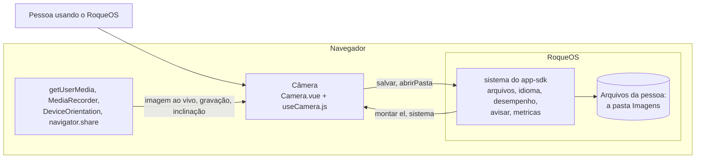
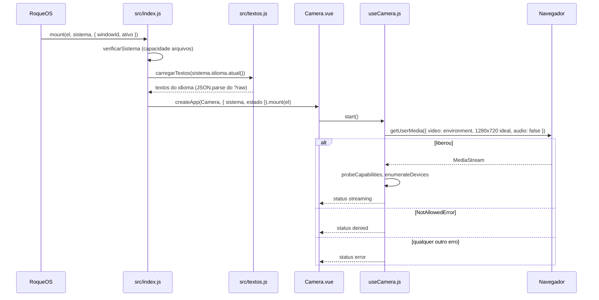
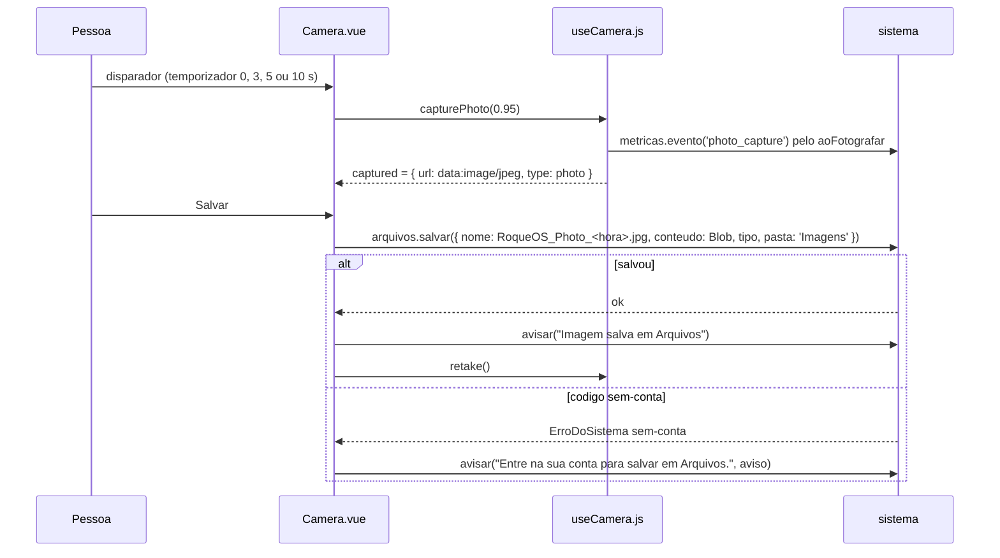
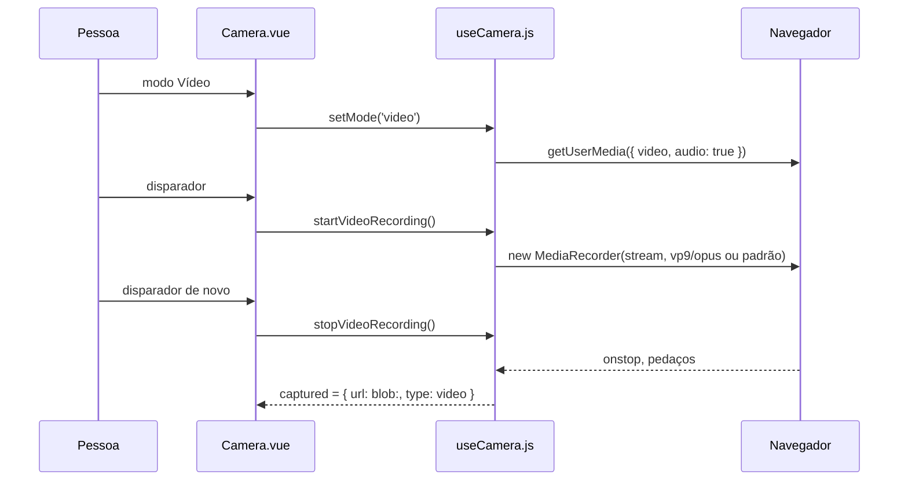
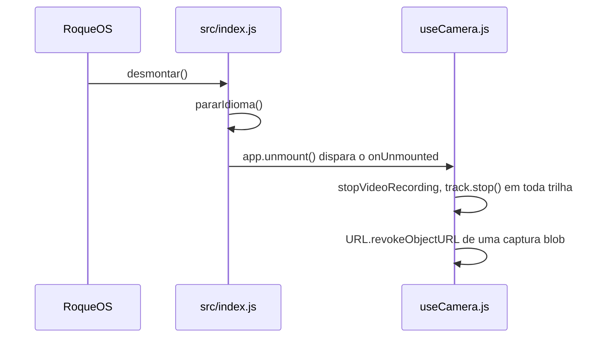

# Arquitetura

_Português | [English](../ARCHITECTURE.md)_

> **Para quem:** quem vai mudar a Câmera e quer o quadro inteiro em meia hora: quem contribui, o mantenedor, um agente.
> **O que tem aqui:** a ideia, o contexto, onde o código roda, cada componente com o arquivo dele, os quatro fluxos principais em diagrama de sequência, os contratos que atravessam fronteira, segurança, as decisões de design e os limites conhecidos.
> **Onde ir para o resto:** para rodar, [COMECAR.md](COMECAR.md); todo comando e arquivo, [REFERENCIA.md](REFERENCIA.md); como o RoqueOS fala com ela, [INTEGRACOES.md](INTEGRACOES.md); o que ela protege, [MODELO-DE-AMEACAS.md](MODELO-DE-AMEACAS.md).

## Sumário

1. [A ideia em um parágrafo](#1-a-ideia-em-um-parágrafo)
2. [Contexto: quem usa e do que depende](#2-contexto-quem-usa-e-do-que-depende)
3. [Processos e onde rodam](#3-processos-e-onde-rodam)
4. [Componentes](#4-componentes)
5. [Os fluxos principais](#5-os-fluxos-principais)
6. [Dados e contratos](#6-dados-e-contratos)
7. [Segurança e segredos](#7-segurança-e-segredos)
8. [Decisões de design](#8-decisões-de-design)
9. [Limites conhecidos](#9-limites-conhecidos)
10. [Como os diagramas são feitos](#10-como-os-diagramas-são-feitos)

## 1. A ideia em um parágrafo

A Câmera é um app do RoqueOS que mora no próprio repositório. É uma tela Vue ([`src/Camera.vue`](../../src/Camera.vue)) em cima de um motor dono do `MediaStream` ([`src/useCamera.js`](../../src/useCamera.js)), embrulhada pelo `definirApp` do `app-sdk` ([`src/index.js`](../../src/index.js)). A câmera e o microfone vêm direto do navegador (`getUserMedia`); tudo o que é do RoqueOS (salvar nos Arquivos, abrir a pasta Imagens, o idioma, o perfil leve, os avisos e as métricas) vem pelo objeto `sistema` que o SDK entrega ao `montar`. O RoqueOS a instala por tag, como dependência git, e o mesmo código roda dentro do RoqueOS, sozinho no navegador (`yarn dev`) e no teste. Ela saiu do núcleo fechado do RoqueOS em 28/09/2026, na Onda 4 do Goal 28 ([README.pt-BR.md](../../README.pt-BR.md)).

## 2. Contexto: quem usa e do que depende



| Depende de                                              | Para quê                                                                                                                | O que acontece quando falta ou falha                                                                                                                                            |
| ------------------------------------------------------- | ----------------------------------------------------------------------------------------------------------------------- | ------------------------------------------------------------------------------------------------------------------------------------------------------------------------------- |
| `navigator.mediaDevices.getUserMedia`                   | a imagem ao vivo, e o microfone no modo vídeo ([`src/useCamera.js`](../../src/useCamera.js))                            | sem ele o motor lança `getUserMedia unsupported` e o visor mostra "Câmera indisponível" com Tentar novamente; permissão recusada mostra "Acesso à câmera negado" e como liberar |
| `MediaRecorder`                                         | a gravação de vídeo                                                                                                     | o motor tenta `video/webm;codecs=vp9,opus`, depois o padrão do navegador; se os dois falham, registra `[useCamera] MediaRecorder unsupported:` e não grava                      |
| `MediaStreamTrack.getCapabilities` / `applyConstraints` | zoom nativo e lanterna                                                                                                  | sem zoom nativo: zoom por recorte (escala CSS na tela, o mesmo recorte na captura); sem lanterna: o botão da lanterna não aparece                                               |
| `DeviceOrientationEvent`                                | o nível                                                                                                                 | no iOS a permissão é pedida com um toque; recusada, o nível fica desligado ([`src/Camera.vue`](../../src/Camera.vue))                                                           |
| `navigator.share`                                       | Compartilhar                                                                                                            | ausente, ou falhando com qualquer coisa que não `AbortError`, Compartilhar cai em Baixar                                                                                        |
| `@roqueos-apps/app-sdk` (tag `v0.3.0`)                  | `definirApp`, o `sistema`, os sistemas de desenvolvimento e falso, o `app check` ([`package.json`](../../package.json)) | o `mount` lança `[camera] o sistema não cumpre o contrato: ...` quando o sistema não oferece `arquivos`                                                                         |
| `@roqueos-apps/ui` (tag `v0.6.0`)                       | os primitivos `RosBotao`, `RosFolha`, `RosIcone`, `RosInterruptor`, `RosVazio`                                          | a tela não compila; o kit chega como fonte `.vue` e o Vitest o embute ([`vite.config.js`](../../vite.config.js))                                                                |
| `vue` `^3.5.0` (peer)                                   | a instância Vue própria do app                                                                                          | quem fornece é o RoqueOS, ou a dependência de desenvolvimento neste repo                                                                                                        |
| A conta da pessoa                                       | `arquivos.salvar` e `arquivos.abrirPasta`                                                                               | sem conta o sistema recusa com `sem-conta`: o app diz "Entre na sua conta para salvar em Arquivos." e a captura fica na tela para Baixar ou Compartilhar                        |

## 3. Processos e onde rodam

| Onde                                                                  | Como sobe                                                                                                                                                                                         | Quem chama                                                                                                                                                                                                                       |
| --------------------------------------------------------------------- | ------------------------------------------------------------------------------------------------------------------------------------------------------------------------------------------------- | -------------------------------------------------------------------------------------------------------------------------------------------------------------------------------------------------------------------------------- |
| Dentro do RoqueOS, no navegador da pessoa, na mesma origem do RoqueOS | o RoqueOS importa o pacote (`ROSCamera: () => import('@roqueos-apps/camera')` nos carregadores de apps gerados do RoqueOS) e chama `mount(el, sistema, { windowId, ativo })` quando a janela abre | o gerenciador de janelas do RoqueOS; quem compila o app é o Vite do próprio RoqueOS, e o [`vite.config.js`](../../vite.config.js) não vai junto                                                                                  |
| Sozinho numa aba do navegador                                         | `yarn dev` (o Vite servindo o [`index.html`](../../index.html), que carrega o [`dev/main.js`](../../dev/main.js))                                                                                 | quem desenvolve; o `montarNaJanelaFalsa` do SDK desenha uma janela falsa do RoqueOS no tamanho do `app.json`, com Arquivos em memória numa conta local                                                                           |
| Vitest sobre jsdom                                                    | `yarn test`                                                                                                                                                                                       | quem desenvolve, o gancho `pre-push` do kit e o CI                                                                                                                                                                               |
| GitHub Actions                                                        | push na `main` e todo pull request, de fork inclusive                                                                                                                                             | o [`.github/workflows/ci.yml`](../../.github/workflows/ci.yml) roda o `yarn verificar`; o [`.github/workflows/dco.yml`](../../.github/workflows/dco.yml) confere o `Signed-off-by` nos pull requests. Nenhum dos dois lê segredo |

Nada deste repositório roda em horário marcado, e não há servidor.

## 4. Componentes

| Arquivo ou pasta                                                     | Responsabilidade                                                                                                                                                                                                                                       | Quem depende                                                                                   |
| -------------------------------------------------------------------- | ------------------------------------------------------------------------------------------------------------------------------------------------------------------------------------------------------------------------------------------------------ | ---------------------------------------------------------------------------------------------- |
| [`app.json`](../../app.json)                                         | quem o app é: `id` permanente (`camera`), nome e descrição em dez idiomas, ícone `photo_camera`, cor `#10b981`, janela 800x600 (mínimo 360x420), capacidade `arquivos`, pasta `Imagens`                                                                | o RoqueOS (registro, janela, permissões), o `app check`, o `dev/main.js`, o `test/app.spec.js` |
| [`src/index.js`](../../src/index.js)                                 | `definirApp`: carrega os textos do idioma, cria o app Vue próprio dentro do elemento que o RoqueOS dá, devolve `{ ativar, desmontar }`; repete as capacidades do `app.json` em `CAPACIDADES`                                                           | o RoqueOS (a entrada `.` do pacote), o `dev/main.js`, os testes                                |
| [`src/Camera.vue`](../../src/Camera.vue)                             | a tela: barra de cima, visor, ajudas de enquadramento (máscara da proporção, grade, nível, anel de foco), zoom de pinça, disparador com temporizador, troca de modo, as ações da captura (descartar, baixar, salvar, compartilhar), a folha de ajustes | o `src/index.js`                                                                               |
| [`src/useCamera.js`](../../src/useCamera.js)                         | o motor: a vida do stream e o status, a sondagem das capacidades, zoom e lanterna, a foto no canvas com espelho, recorte da proporção e recorte do zoom por CSS, o vídeo com `MediaRecorder`, a limpeza ao desmontar                                   | o `src/Camera.vue`, o `test/useCamera.spec.js`                                                 |
| [`src/textos.js`](../../src/textos.js)                               | o mapa estático de dez carregadores (JSON com `?raw`), `carregarTextos` e `traduzir`                                                                                                                                                                   | o `src/index.js`, o `src/Camera.vue`, o `test/textos.spec.js`                                  |
| [`src/camera.scss`](../../src/camera.scss)                           | o visual: variáveis `--camera-*` sobre as `--ros-*-rgb` do contrato, o perfil leve, a tela compacta por `@container (max-width: 560px)`                                                                                                                | o `src/Camera.vue`, o `test/estilo.spec.js`                                                    |
| [`i18n/`](../../i18n/pt-BR.json)                                     | os textos da tela, um JSON por idioma, chaves planas                                                                                                                                                                                                   | o `src/textos.js`, o `app check`, o `test/textos.spec.js`                                      |
| [`dev/main.js`](../../dev/main.js), [`index.html`](../../index.html) | a janela falsa avulsa do `yarn dev`                                                                                                                                                                                                                    | quem desenvolve                                                                                |
| [`test/`](../../test/app.spec.js)                                    | Vitest: a tela pelo SDK, o motor, as chaves de texto, a regra de estilo; o [`test/preparar.js`](../../test/preparar.js) supre o que o jsdom não tem                                                                                                    | o gate, e o `paridade.json` cita os títulos dos testes                                         |
| [`paridade.json`](../../paridade.json)                               | o inventário do que a Câmera fazia dentro do RoqueOS e do que aconteceu com cada item (48 itens: 41 mantidos, 7 mudaram, 0 perdidos)                                                                                                                   | o RoqueOS, que confere o arquivo no pacote instalado                                           |
| [`ASSETS.md`](../../ASSETS.md)                                       | origem e licença das mídias; a Câmera não tem `public/`                                                                                                                                                                                                | o `app check`                                                                                  |

## 5. Os fluxos principais

### 5.1 Abrir a janela

O RoqueOS chama o `mount`; o SDK confere o sistema contra as capacidades declaradas; o `montar` carrega os textos do idioma atual e só então monta o Vue, para nenhum botão aparecer sem rótulo ([`src/index.js`](../../src/index.js)). Ao montar, a tela chama `cam.start()`, que pede a câmera traseira em 720p, com áudio só no modo vídeo ([`src/useCamera.js`](../../src/useCamera.js)).



### 5.2 Tirar e salvar uma foto

Com temporizador de 3, 5 ou 10 segundos o disparador conta primeiro; depois o motor desenha o quadro num canvas (espelho na câmera frontal, recorte da proporção, recorte do zoom por CSS) e guarda uma URL de dados JPEG com qualidade 0,95. Salvar vira um Blob e entrega ao `sistema.arquivos.salvar` com o nome permanente ([`src/Camera.vue`](../../src/Camera.vue)).



### 5.3 Gravar um vídeo

Trocar para vídeo reinicia o stream com o microfone. O disparador começa e termina um `MediaRecorder`; ao parar, os pedaços viram um Blob `video/webm` atrás de uma URL `blob:`, e Salvar dá o nome `RoqueOS_Video_<hora>.webm` ([`src/useCamera.js`](../../src/useCamera.js)).



### 5.4 Fechar a janela

Fechar chama o `desmontar`: ele para de ouvir a troca de idioma e desmonta o Vue; o `onUnmounted` do motor para todas as trilhas, e a luz do aparelho apaga, e revoga a URL `blob:` de um vídeo não salvo ([`src/index.js`](../../src/index.js), [`src/useCamera.js`](../../src/useCamera.js)). O teste "fechar a janela desliga a câmera e solta o ouvinte do idioma" do [`test/app.spec.js`](../../test/app.spec.js) confere.



## 6. Dados e contratos

A cara do app para o RoqueOS é o export padrão do [`src/index.js`](../../src/index.js), criado por `definirApp({ id: 'camera', capacidades: ['arquivos'], montar })`. Tudo o que ele pede ao sistema, com a chamada exata:

```js
await sistema.arquivos.salvar({
  nome: 'RoqueOS_Photo_1727500000000.jpg', // or RoqueOS_Video_<Date.now()>.webm
  conteudo: blob,
  tipo: 'image/jpeg', // blob.type, or video/webm
  pasta: 'Imagens',
})
await sistema.arquivos.abrirPasta('Imagens')
sistema.metricas.evento('photo_capture')
sistema.avisar(texto, { tipo: 'sucesso' | 'aviso' | 'erro', titulo })
sistema.idioma.atual() // and sistema.idioma.aoMudar(fn)
sistema.desempenho.modoLeve()
```

O nome do arquivo é `RoqueOS_Photo_<Date.now()>.jpg` ou `RoqueOS_Video_<Date.now()>.webm`; o começo é permanente ([guia de contribuição](CONTRIBUTING.md)). O nome da métrica `photo_capture` é o de antes da saída, porque o histórico depende dele ([`src/Camera.vue`](../../src/Camera.vue)). Os arquivos de texto são objetos planos, chave para texto, com as mesmas chaves nos dez idiomas:

```json
{ "permissionDenied": "Camera access denied", "semConta": "Sign in to save to Files." }
```

O formato do [`app.json`](../../app.json) e do [`paridade.json`](../../paridade.json), campo a campo, está em [REFERENCIA.md](REFERENCIA.md#formatos).

## 7. Segurança e segredos

O repositório não tem segredo, `.env` nem backend. O app não fala com banco nem com o Storage; o `app check` reprova import do Firebase ou de dentro do RoqueOS. Ele só abre a pasta que declara (`Imagens`) e nunca vê caminho nem lista os arquivos da pessoa. A imagem ao vivo não sai do aparelho; a captura só sai quando a pessoa aperta Salvar, Baixar ou Compartilhar. O CI roda em `pull_request` (nunca `pull_request_target`), com permissão só de leitura e sem segredo ([`.github/workflows/ci.yml`](../../.github/workflows/ci.yml)). A política e o canal de relato estão no [SECURITY.md](../../SECURITY.md); as ameaças e o que não é protegido, no [MODELO-DE-AMEACAS.md](MODELO-DE-AMEACAS.md).

## 8. Decisões de design

| Decidido                                                                            | Alternativa recusada                        | Por quê                                                                                                                                                                                      | Quando                                                         |
| ----------------------------------------------------------------------------------- | ------------------------------------------- | -------------------------------------------------------------------------------------------------------------------------------------------------------------------------------------------- | -------------------------------------------------------------- |
| Repositório próprio, instalado por tag, falando com o RoqueOS só pelo `app-sdk`     | ficar dentro do núcleo fechado              | o app pode ser aberto (MIT) e conferido sozinho; o RoqueOS mantém um contrato só com todo app                                                                                                | 28/09/2026, Goal 28 ([README.pt-BR.md](../../README.pt-BR.md)) |
| Câmera e microfone direto do navegador                                              | uma capacidade `camera` no SDK              | o sistema não media nada ali, então o SDK não tem essa capacidade ([`src/index.js`](../../src/index.js))                                                                                     | na saída, 28/09/2026                                           |
| JSON de texto carregado como texto (`?raw`) e `JSON.parse`                          | import de JSON direto                       | o build do RoqueOS quebra com import de JSON fora do `src/i18n/` dele (o plugin do vue-i18n embrulha o `vite:json`); medido nos jogos em 25/09/2026 ([`src/textos.js`](../../src/textos.js)) | 25/09/2026                                                     |
| Um mapa estático de dez carregadores                                                | `import()` com variável                     | o Vite desistiria de recortar e empacotaria os dez idiomas juntos, em silêncio ([`src/textos.js`](../../src/textos.js))                                                                      | na saída, 28/09/2026                                           |
| O `src/index.js` repete as capacidades do `app.json`, e um teste compara            | importar o `app.json` na entrada            | o mesmo limite do build; o teste "o id e as capacidades são os do manifesto, e o manifesto é válido" vigia a deriva                                                                          | na saída, 28/09/2026                                           |
| Proporção como recorte no canvas na captura                                         | uma restrição `aspectRatio` exata           | os aparelhos raramente obedecem, e o arquivo salvo tem de bater com a máscara de enquadramento ([`src/useCamera.js`](../../src/useCamera.js))                                                | veio do RoqueOS sem mudança                                    |
| Sem zoom nativo, recortar o centro (escala CSS na tela, o mesmo recorte na captura) | sem zoom nesses aparelhos                   | a maioria dos computadores e o Safari do iOS não expõem a capacidade `zoom` ([`src/useCamera.js`](../../src/useCamera.js))                                                                   | veio do RoqueOS sem mudança                                    |
| Começo do nome do arquivo e `id` permanentes                                        | renomear                                    | um começo novo separa as fotos novas das antigas nas Imagens; o `id` é por onde o RoqueOS acha a janela, o atalho e o lugar dela no Big Picture ([guia de contribuição](CONTRIBUTING.md))    | na saída, 28/09/2026                                           |
| Sem conta, recusar Salvar e manter a captura                                        | tentar salvar como `guest`                  | a tentativa antiga sempre falhava com "Erro ao salvar imagem" ([CHANGELOG.md](../../CHANGELOG.md), 0.1.0)                                                                                    | 28/09/2026                                                     |
| Tela compacta pela largura da janela, `@container (max-width: 560px)`               | pela largura da página, `@media` até 768 px | uma janela pequena na mesa também tem de caber ([`src/camera.scss`](../../src/camera.scss), `paridade.json`)                                                                                 | 28/09/2026                                                     |
| Margem de baixo por `var(--safe-area-inset-bottom, env(...))`                       | só o `env()`                                | no app do iPhone o `env()` zera quando uma folha trava o body; só o `env()` punha o disparador embaixo da barra de gestos ([`test/estilo.spec.js`](../../test/estilo.spec.js))               | 0.1.1, 28/09/2026                                              |
| O kit de interface por HTTPS (`github:roqueos-apps/ui#v0.6.0`)                      | `git+ssh`                                   | o GitHub Actions não instalava sem chave: `Permission denied (publickey)`, medido em 29/09/2026 ([CHANGELOG.md](../../CHANGELOG.md))                                                         | 29/09/2026                                                     |

## 9. Limites conhecidos

- O perfil leve é lido uma vez, quando o app abre ([`src/index.js`](../../src/index.js)): ligar ou desligar nos Ajustes do RoqueOS com a Câmera aberta só vale ao reabrir. Antes da saída reagia ao vivo (`paridade.json`, item "Visual leve no perfil leve").
- Desfoque (20px), raio (12px) e transição (200ms) são fixos; um tema que mude esses valores não chega mais à Câmera. As cores continuam seguindo as variáveis do tema (`paridade.json`).
- O anel de foco é só o gesto: o código desenha o anel onde a pessoa tocou e não aplica restrição de foco nenhuma ([`src/Camera.vue`](../../src/Camera.vue)).
- O Blob do vídeo sai sempre rotulado `video/webm`, mesmo quando o `new MediaRecorder(stream)` de reserva escolheu o formato do próprio navegador ([`src/useCamera.js`](../../src/useCamera.js)). O que o Safari grava sob esse rótulo não foi medido.
- A resolução é uma restrição `ideal`: o aparelho pode entregar outro tamanho. O 720p padrão não tem teste (`paridade.json`, primeiro item).
- O nível lê só o `gamma` (inclinação para os lados), preso em ±45 graus, e conta como reto abaixo de 1,5 grau ([`src/Camera.vue`](../../src/Camera.vue)).
- O zoom por recorte vai até 4x; o zoom nativo usa a faixa que o aparelho declara.
- Todo teste automático roda no jsdom com uma câmera de mentira ([`test/app.spec.js`](../../test/app.spec.js)). O comportamento numa câmera de verdade é conferido à mão no `yarn dev` e dentro do RoqueOS; nenhum teste automático prova.
- O `roqueos-docs` da família não faz parte do `yarn verificar`: a documentação pode derivar sem o gate reprovar.

## 10. Como os diagramas são feitos

Todo diagrama daqui é Mermaid dentro do Markdown, renderizado pelo GitHub; a fonte é o texto, e o par em inglês traduz os rótulos. A capa do README, [`capa.jpg`](../capa.jpg), é um print do app dentro do RoqueOS tirado com o Playwright e a câmera falsa do Chromium em 28/09/2026; a origem está no [ASSETS.md](../../ASSETS.md).
